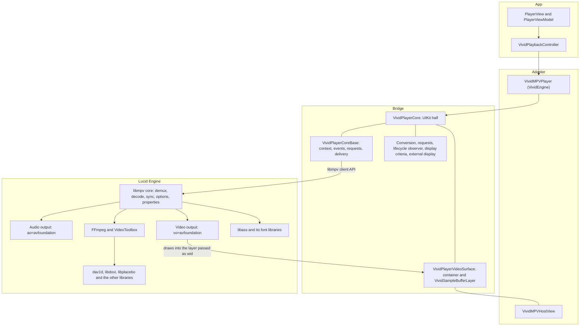
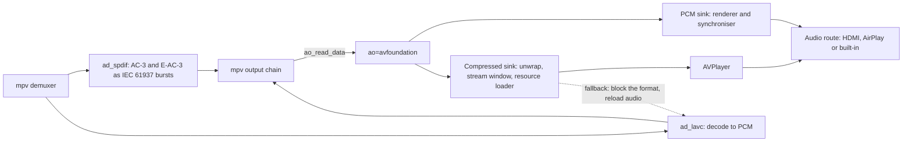
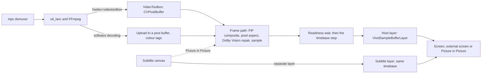
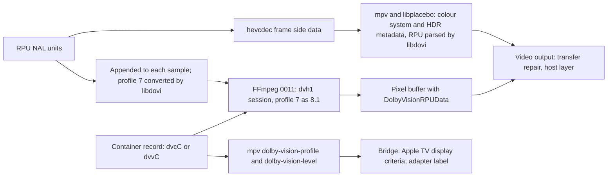

<p align="center"></p>
<p align="center"><strong>Vivid</strong></p>
<h1 align="center">Lucid Engine architecture</h1>
<p align="center"><a href="../README.md">Documentation</a> · <a href="player-engine.md">Lucid Engine</a> · <a href="lucid-engine-build.md">Build pipeline</a> · <a href="../playback/lucid-engine-patch-spec.md">Patch specification</a> · <a href="https://github.com/blurbery/vivid/blob/8a49188733f01d9567be06a72bd24aebc7289c90/docs/playback/player-bridge-spec.md">Bridge specification</a></p>

---

How Vivid's player fits together, from the player screen down to the libraries inside Lucid Engine: the layers, how audio, video, subtitles, Dolby Vision metadata, TLS and logs move through them, which threads each part runs on, which tests guard each part, how the engine is built and shipped, and where to start when you change a part.

Two specifications remain the contracts: the [player bridge specification](https://github.com/blurbery/vivid/blob/8a49188733f01d9567be06a72bd24aebc7289c90/docs/playback/player-bridge-spec.md) for Vivid's Swift bridge, and the [Lucid Engine patch specification](../playback/lucid-engine-patch-spec.md) for Vivid's engine patches. This guide is a map of them. Where it and a specification differ, the specification wins. "Bridge 5.3" and "engine 4.16.6" below mean those sections of the two specifications.

> [!NOTE]
> Until the two experiment branches are merged, the work sits in two places:
> - **App side** (screens, adapter, bridge, app tests, the player regression workflow and its pin checks): `experiment/vivid-player-bridge` at `8a49188`. Links to these files point at that commit, because `experiment/lucid-engine-build` still carries an earlier copy of the bridge and of its specification, without the bridge specification's section 17 amendments.
> - **Engine side** (`engine/`, its patches and host tests, and the [Lucid Engine build workflow](../../.github/workflows/lucid-engine.yml)): `experiment/lucid-engine-build` at `6a85f8b`, the branch this guide was written on.

> [!IMPORTANT]
> The bridge and the engine patches were written clean-room. Before changing either, read the reading rules in bridge section 2 and engine section 1.4 and keep to them. They list sources that must never be opened, including the previous bridge's files in Git history.

## Two engine states

The pipeline has moved on since the package release the app links. Keep the two apart when you read results, notices or device reports.

<table width="100%">
  <thead>
    <tr><th align="left"></th><th align="left">Pipeline at <code>6a85f8b</code></th><th align="left" width="10000">Package the app pins: <code>blurbery/lucid-engine</code> prerelease <code>0.1.0-interim.1</code> (commit <code>11d60dc</code>)</th></tr>
  </thead>
  <tbody>
    <tr><td>Built from upstream source by Vivid's pipeline</td><td>All 16 libraries: 21 static frameworks and MoltenVK's <code>libMoltenVK.a</code></td><td>Eleven frameworks (<code>Libmpv</code>, the seven FFmpeg frameworks, <code>Libass</code>, <code>Libdav1d</code>, <code>Libdovi</code>), built at <code>10faa2a</code> in run 38400124717</td></tr>
    <tr><td>mpv and FFmpeg patches</td><td>mpv <code>0001</code>, <code>0002</code>, <code>0010</code> to <code>0016</code>, <code>0020</code> to <code>0025</code>, <code>0040</code>; FFmpeg <code>0001</code>, <code>0002</code>, <code>0010</code> to <code>0012</code></td><td>The same patches. Only FFmpeg <code>0011</code>'s description has changed since (it now says two error lines are logged when the Dolby Vision configuration cannot be added); its code is the same</td></tr>
    <tr><td>libass</td><td>0.17.5 with <code>0001</code>, <code>0002</code> and <code>0010</code></td><td>0.17.5 unpatched (the series was empty then)</td></tr>
    <tr><td>libdovi</td><td>3.3.2 with Vivid's <code>0001</code></td><td>The same</td></tr>
    <tr><td>FreeType, FriBidi, HarfBuzz, libunibreak, libplacebo, Little CMS, MoltenVK, shaderc, uavs3d, libbluray, uchardet</td><td>Built from upstream source; libbluray and uavs3d with Vivid's own patch</td><td>Interim prebuilt binaries, pinned by URL and SHA-256 in the package's <code>Package.swift</code> and not hosted by the package</td></tr>
    <tr><td>Device checks of Vivid's engine patches</td><td>Not run yet</td><td>Not run yet</td></tr>
  </tbody>
</table>

## Layers



### App screens and the player view model

The player screen and its view model never call libmpv. They own product state (controls, queues, resume and Next Up, progress reporting and server sessions) and reach the engine through one controller. All of them run on the main actor.

<table width="100%">
  <thead>
    <tr><th align="left">Type</th><th align="left">File (under <code>iosApp/iosApp/</code>)</th><th align="left" width="10000">Role</th></tr>
  </thead>
  <tbody>
    <tr><td><code>PlayerView</code></td><td><code>Screens/Player/PlayerView.swift</code></td><td>The SwiftUI player screen. It mounts <code>VividPlayerSurface</code>, a <code>UIViewRepresentable</code> around the adapter's persistent host view, under Vivid's own controls.</td></tr>
    <tr><td><code>PlayerViewModel</code></td><td><code>Screens/Player/PlayerViewModel.swift</code></td><td>Transport, Next Up and end-of-item decisions; reaches the engine through <code>vividEngine</code>.</td></tr>
    <tr><td><code>VividPlaybackController</code></td><td><code>Screens/Player/VividPlaybackController.swift</code></td><td>The production boundary around <code>VividEngine</code>: the one generation-fenced owner of loads, transport and engine observation.</td></tr>
    <tr><td><code>PictureInPictureCoordinator</code> (iOS)</td><td><code>Screens/Player/iOS/PictureInPictureCoordinator.swift</code></td><td>Builds Picture in Picture from the core's display layer (through <code>SampleBufferPiPSource</code>) and sets the adapter's Picture in Picture flag.</td></tr>
    <tr><td><code>VividSubtitleOverlay</code></td><td><code>Screens/Player/VividSubtitleOverlay.swift</code></td><td>Draws external plain-text subtitles from the adapter's cues.</td></tr>
    <tr><td><code>LucidSubtitleInventory</code></td><td><code>Playback/MPV/LucidSubtitleInventory.swift</code></td><td>The detail page's subtitle probe: its own headless mpv context, read in a detached task with a bare <code>VividPlayerCoreBase</code> for node conversion.</td></tr>
    <tr><td><code>PlaybackSessionRecorder</code>, <code>PlaybackTrialTrace</code></td><td><code>Shared/Diagnostics/Playback/</code>, <code>Playback/PlaybackTrialTrace.swift</code></td><td>The latest-playback report with its fault labels (every build), and the bounded trace of trial builds.</td></tr>
  </tbody>
</table>

### The adapter

[`VividMPVPlayer`](https://github.com/blurbery/vivid/blob/8a49188733f01d9567be06a72bd24aebc7289c90/iosApp/iosApp/Playback/MPV/VividMPVPlayer.swift) (aliased as `VividEngine`) is a main-actor class that turns Vivid's load options into one engine session per load.

- **One core per load.** Each load creates a `VividMPVCore`, a private subclass of the bridge's `VividPlayerCore`, sets its options, calls `initialize(in:hostView:)`, registers 21 property observations and issues `loadfile`. The previous core is disposed with `preserveDisplayCriteria: true`, so consecutive episodes of one format keep the TV's mode; the final stop disposes with `false` (bridge 8.13).
- **Engine options.** Its options hook, `configurePlatformMpvOptions(mpv:)`, runs inside `initialize`, after the bridge's own options and before `mpv_initialize`: `ao=avfoundation`, `audio-spdif`, `ao-avfoundation-manage-audio-session=no`, the packet cache limits, `cache-secs` on tvOS, the six `ao-avfoundation-*` AirPlay options on tvOS, `http-header-fields` as a typed string list, `tls-verify` through `LucidTLS`, and the `vividstream` protocol when Vivid's managed reader is used (bridge 6.3, 6.19).
- **Audio session.** Vivid owns `AVAudioSession`, not the engine. The adapter sets category playback, mode moviePlayback and long-form route sharing and activates the session before each load, retrying briefly while a new route settles. It deactivates it only after every retired core's `dispose` completion has left a shared `DispatchGroup`, and only while its own ownership token is still current.
- **Events into state.** `file-loaded` marks the session ready and `playback-restart` the first picture. `end-file` either fails the load (it carries an `error`) or starts a 250 ms end-of-stream confirmation that a queued error, a stop, a new load or a seek can still cancel.
- **Log matching.** `log-message` events are matched against fixed demuxer and audio output lines and become fault labels and trace fields (see [Logs and events](#logs-and-events)).
- **Surface.** `VividMPVHostView`, one per adapter and kept across loads, calls the core's `updateFrame()` on every layout pass. The delegate proxy, `VividMPVDelegate`, passes each delivery on to the adapter through a main-actor `Task`.
- **Silo HTTPS reads.** `VividManagedStream.swift` and `VividManagedStreamProtocol.swift` read Silo direct-play HTTPS streams with URLSession and serve them to libmpv through its stream callbacks.
- **TLS.** `LucidTLS.swift` decides whether to turn on certificate checks for the streams Lucid reads itself (see [TLS](#tls)).

### The bridge

Vivid's own Swift layer between the adapter and libmpv, written from the bridge specification. It owns one mpv client context per load with its options, event loop and teardown; ordered delivery of properties and events to the main thread; asynchronous requests with exactly-once completions; the video surface; Match Content on Apple TV and EDR on iPhone and iPad; reactions to the app entering the background and returning; and video on an external screen on iPhone and iPad (bridge 1.1). It does not render frames, own the audio session, choose tracks (apart from one hook the adapter drives) or talk to any server. Every console line it prints starts with `[VividPlayerCore]`.

It is split into a centre and outer parts (bridge 17.1), all in [`iosApp/iosApp/Playback/MPV/`](https://github.com/blurbery/vivid/tree/8a49188733f01d9567be06a72bd24aebc7289c90/iosApp/iosApp/Playback/MPV):

<table width="100%">
  <thead>
    <tr><th align="left">Part</th><th align="left">File</th><th align="left" width="10000">What it owns</th></tr>
  </thead>
  <tbody>
    <tr><td>Core base (centre, engine half)</td><td><code>VividPlayerCoreBase.swift</code></td><td>Creating the mpv context and setting the bridge's options (<code>vo=avfoundation</code>, <code>avfoundation-composite-osd=no</code>, <code>avfoundation-presentation=host</code> on Apple TV devices, <code>hwdec</code>, <code>keep-open=yes</code>); the per-core event queue, the wakeup relay and the event drain; the ten internal observations; synchronous reads; the <code>on_preloaded</code> hook; ordered delivery with coalescing; liveness and the start of disposal. Declares <code>VividPlayerCoreDelegate</code> and <code>VividPlayerCoreError</code>.</td></tr>
    <tr><td>Core (centre, UIKit half)</td><td><code>VividPlayerCore.swift</code></td><td><code>initialize(in:hostView:)</code> and <code>dispose(preserveDisplayCriteria:completion:)</code>; the Picture in Picture flag and <code>setPipSubtitleCompositing</code>; layout; background and return (<code>vid=no</code>, <code>vid=auto</code> and the paused redraw); the wiring of the outer parts. Declares <code>VividSampleBufferLayer</code>.</td></tr>
    <tr><td>MPV conversion</td><td><code>VividPlayerMPVConversion.swift</code></td><td>Stateless conversion of mpv's C strings (UTF-8, otherwise byte for byte) and <code>mpv_node</code> trees, within a budget of 4,096 nodes, 16 MiB and depth 32, and the 16,384-pixel dimension check (bridge 6.16).</td></tr>
    <tr><td>Requests</td><td><code>VividPlayerRequests.swift</code></td><td><code>VividPlayerRequestTable</code>, the numbered pending requests that each complete exactly once, and <code>VividPlayerPauseTracker</code>, the displayed and confirmed pause state (bridge 6.12, 6.13).</td></tr>
    <tr><td>Lifecycle observer</td><td><code>VividPlayerLifecycleObserver.swift</code></td><td>Scene notifications on iOS and application notifications on tvOS, plus the display mode-switch notifications in tvOS trial builds (bridge 6.18).</td></tr>
    <tr><td>Video surface</td><td><code>VividPlayerVideoSurface.swift</code></td><td>The black container at index 0 of the host view, the layer passed to mpv as <code>wid</code>, the iOS cover view, and geometry written only with final values and without animation (bridge 7).</td></tr>
    <tr><td>Display criteria</td><td><code>VividPlayerDisplayCriteria.swift</code></td><td>Match Content on Apple TV (the holds, the source epoch, the early and restart snapshots, and merged writes of <code>AVDisplayCriteria</code>) and EDR on the layer on iPhone and iPad (bridge 8).</td></tr>
    <tr><td>External display (iOS)</td><td><code>VividExternalDisplay.swift</code></td><td>The process-wide coordinator that adopts an external-display scene, and the role test (bridge 9).</td></tr>
  </tbody>
</table>

### libmpv's core

Upstream mpv 0.41.0, built as a library (`-Dlibmpv=true`, `-Dcplayer=false`, `-Dgpl=false`, Lua and JavaScript off; [`engine/config/mpv-meson.txt`](../../engine/config/mpv-meson.txt)). Vivid reaches it only through two of its public headers, `client.h` and `stream_cb.h` (the latter for the managed reader; bridge 2.1). The core demuxes and caches packets (up to 256 MiB ahead and 16 MiB behind, and on Apple TV at most 60 seconds ahead), decodes through FFmpeg, runs the audio filters and output chain, keeps video on the audio clock (mpv's default `video-sync=audio`), decodes subtitles and hands them to the video output as bitmaps, and drives the audio and video outputs. Anything the patch specification does not mention behaves as upstream (engine 1.2).

Vivid's patches inside the core itself are small: mpv `0001` (upstream commit `1388a453`, unchanged: the S/PDIF muxer is recreated after a reset), `0010` (E-AC-3 passthrough at four times the stream's codec rate, engine 6.4), `0011` (the output chain is woken after a hard reset, so audio does not stall after an output reload or a passthrough fallback, engine 6.2) and `0040` (see [Decoder](#decoder)).

### Audio output

`ao=avfoundation` (log prefix `ao/avfoundation`, options `ao-avfoundation-*`; engine 2.1, 2.2) is a pull-based driver: mpv's core calls `init`, `uninit`, `control`, `reset`, `start` and `set_pause`, and the driver reads audio with `ao_read_data` when its sink needs more. It has two sinks: the PCM sink (`AVSampleBufferAudioRenderer` with `AVSampleBufferRenderSynchronizer`) for decoded audio, and the compressed sink (`AVPlayer`, fed through an `AVAssetResourceLoader` delegate) for AC-3 and E-AC-3 passthrough. Any other S/PDIF format is refused at `init`, so mpv decodes it to PCM (engine 3.1). The patches add the pure C decisions first and the Objective-C bindings last, and each adds its own files to `meson.build`, so every stage of the series builds.

<table width="100%">
  <thead>
    <tr><th align="left">Module</th><th align="left">Patch</th><th align="left">Files (<code>audio/out/</code>)</th><th align="left" width="10000">What it holds</th></tr>
  </thead>
  <tbody>
    <tr><td>Build support</td><td>mpv <code>0002</code></td><td><code>ao_avfoundation.m</code>, <code>ao_coreaudio_*</code></td><td>Lets upstream's AVFoundation output build for iOS and tvOS: CoreAudio HAL code stays macOS-only, and mpv's CoreFoundation string helpers are built.</td></tr>
    <tr><td>Centre</td><td>mpv <code>0012</code></td><td><code>ao_avfoundation_core.c</code></td><td>The audio session rules with <code>manage-audio-session</code>, the process-wide passthrough block, the order of <code>init</code>'s refusals, trace edges and the prefetch guard.</td></tr>
    <tr><td>PCM sink</td><td>mpv <code>0013</code></td><td><code>ao_avfoundation_pcm.c</code></td><td>Upstream's renderer behaviour on iOS and unbounded tvOS; on tvOS with <code>max-lookahead</code>, a bounded, timer-fed renderer queue with a fresh renderer after every reset.</td></tr>
    <tr><td>AirPlay start-up</td><td>mpv <code>0014</code></td><td><code>ao_avfoundation_startup.c</code></td><td>Passthrough start-up supervision: rate 1 once primed, engagement, one recovery seek with the first-start grace, slow-source extensions, fallback, and the start and resume anchoring that keeps video waiting for AirPlay audio.</td></tr>
    <tr><td>Compressed passthrough</td><td>mpv <code>0015</code></td><td><code>ao_avfoundation_compressed.c</code>, <code>ao_avfoundation_iec61937.c</code></td><td>IEC 61937 unwrapping, the stream window and serving, filling, clocks, diagnostics, the end-of-file resume and the fallback to PCM.</td></tr>
    <tr><td>Objective-C bindings</td><td>mpv <code>0016</code></td><td><code>ao_avfoundation.m</code>, <code>ao_avfoundation_av.h</code>, <code>ao_avfoundation_pcm_av.m</code>, <code>ao_avfoundation_compressed_av.m</code></td><td>The driver and its options (<code>max-lookahead</code> on tvOS only), the AO queue, <code>AVAudioSession</code>, the renderer and synchroniser, and <code>AVPlayer</code> with its resource loader.</td></tr>
  </tbody>
</table>

### Video output

Upstream mpv has no `avfoundation` video output; patch `0025` adds `vo=avfoundation` as the meson feature `vo-avfoundation`, registers it first in `video/out/vo.c` (ahead of `gpu-next`), adds the `avfoundation-*` options and registers a VideoToolbox device named `avfoundation`, so that `hwdec=videotoolbox` decodes straight into frames the output accepts (engine 2.1, 2.3). The output puts frames on the layer passed as `wid` as timed sample buffers, owns that layer's `controlTimebase`, adds a sibling subtitle layer, and never scales, tone-maps or re-renders the picture apart from the Picture in Picture subtitle composite (engine 4). Its modules come first in the series (`0020` to `0024`, which `meson.build` does not build until `0025`).

<table width="100%">
  <thead>
    <tr><th align="left">Module</th><th align="left">Patch</th><th align="left">Files</th><th align="left" width="10000">What it holds</th></tr>
  </thead>
  <tbody>
    <tr><td>Timing and pacing</td><td>mpv <code>0020</code></td><td><code>video/out/avfoundation/clock.c</code>, <code>timebase.c</code>, <code>pacing.c</code></td><td>The playback rate estimator, the media-mode timebase servo, the CoreMedia timebase and frame pacing (readiness wait, deadline drops, recovery throttle).</td></tr>
    <tr><td>Pixels and geometry</td><td>mpv <code>0021</code></td><td><code>pixels.c</code>, <code>geometry.c</code>, <code>pool.c</code></td><td>Upload copies and direct subtitle blends (vectorised with NEON on arm64, bit for bit equal to their scalar forms), the YUV subtitle composite, the host layer's pixel size and frame-space geometry, and the CoreVideo pools.</td></tr>
    <tr><td>Frame path</td><td>mpv <code>0022</code></td><td><code>frame.m</code></td><td>Software uploads and colour tags, pixel aspect, the Dolby Vision transfer repair, samples, and Picture in Picture composites that blend each cue exactly once and keep the changed rows.</td></tr>
    <tr><td>Subtitles</td><td>mpv <code>0023</code></td><td><code>subtitles.c</code></td><td>Every subtitle object in one canvas, change and dirty tracking, and timed subtitle samples.</td></tr>
    <tr><td>Layers</td><td>mpv <code>0024</code></td><td><code>layers.m</code></td><td>The host and subtitle layers, their renderers and timebase, the main-thread hops, the resize and app-state observers, and the layers' last release on the main thread.</td></tr>
    <tr><td>Centre and registration</td><td>mpv <code>0025</code></td><td><code>video/out/vo_avfoundation.m</code>, <code>video/out/vo.c</code>, <code>meson.build</code>, <code>meson.options</code></td><td>The driver itself, its options and the VideoToolbox device.</td></tr>
  </tbody>
</table>

The output has two presentation modes (engine 4.8). In `host` mode, used on Apple TV, the timebase follows the host clock and frames are presented at the times mpv schedules. In `media` mode, used on iPhone and iPad, the timebase follows media time through a rate servo, which Picture in Picture needs. The bridge sets `host` on Apple TV devices; the tvOS build's default gives the tvOS simulator `host` too.

### Decoder

Decoding is FFmpeg's, through mpv's `vd_lavc`, with VideoToolbox on devices (`hwdec=videotoolbox`, `hwdec-codecs=all`) and software decoding in the simulators and after a fallback. Vivid's changes:

<table width="100%">
  <thead>
    <tr><th align="left">Patch</th><th align="left">Files</th><th align="left" width="10000">Change</th></tr>
  </thead>
  <tbody>
    <tr><td>FFmpeg <code>0002</code></td><td><code>libavcodec/videotoolbox.c</code></td><td>VideoToolbox's output buffers are Metal-compatible, with neither OpenGL compatibility key (engine 5.10).</td></tr>
    <tr><td>FFmpeg <code>0010</code></td><td><code>libavcodec/videotoolbox.c</code></td><td>Every sample handed to VideoToolbox carries an explicit sample size, for every codec. VideoToolbox's Dolby Vision HEVC decoder fails samples without one (engine 5.5).</td></tr>
    <tr><td>FFmpeg <code>0011</code></td><td><code>libavcodec/videotoolbox_dovi.c</code> (new), <code>videotoolbox.c</code>, <code>vt_internal.h</code>, <code>Makefile</code></td><td>Dolby Vision profiles 5, 7 and 8 through VideoToolbox's Dolby Vision HEVC (<code>dvh1</code>) decoder; profile 7 presented as 8.1 with its RPUs converted by libdovi; the per-frame HDR metadata session properties; one plain HEVC retry when VideoToolbox refuses a profile 7 or 8 session (engine 5).</td></tr>
    <tr><td>FFmpeg <code>0012</code></td><td><code>libavcodec/hevc/hevcdec.c</code></td><td>Two hevcdec messages that can fire on every frame are logged at verbose instead of warning and info (engine 6.6).</td></tr>
    <tr><td>mpv <code>0040</code></td><td><code>video/decode/vd_lavc.c</code></td><td>Once hardware decoding has output a frame, a run of decoding errors ends it only after two keyframes fail to recover it or after 240 errors, instead of at the first error; probing still falls back at once (engine 6.1).</td></tr>
  </tbody>
</table>

### libass and its series

libass 0.17.5 renders text subtitles, on one thread, with FreeType, FriBidi, HarfBuzz and libunibreak. Its series gives static events today's change reports and font behaviour (engine 13.4; [build guide](lucid-engine-build.md)):

- `0001`: upstream libass commit `057a5334`, unchanged, with its upstream attribution. Symbol fonts given non-Latin text place their glyphs as before.
- `0002`: upstream libass pull request #951 at `f96a521a`, unchanged, with its upstream attribution. The finished images of events that do not depend on time are cached within 32 MiB, so an unchanged sign or boxed line reports no change and repeats no font search.
- `0010`: Vivid's own patch (ISC). Unresolved glyphs stay with their event, which finds its own cache entry first, so a static event searches for them once per appearance however full the cache is; a new fallback face renders such events once more, the event's Effect joins the cache key, the cache is emptied on every state change, and image clones keep their type.

### The libraries

<table width="100%">
  <thead>
    <tr><th align="left">Library</th><th align="left">Version</th><th align="left">Vivid patch</th><th align="left" width="10000">Role in Vivid's playback (engine 13.5)</th></tr>
  </thead>
  <tbody>
    <tr><td>FFmpeg</td><td>n8.0.1</td><td><code>0001</code>, <code>0002</code>, <code>0010</code> to <code>0012</code></td><td>Demuxers, decoders, the VideoToolbox hwaccel, network protocols and Secure Transport TLS.</td></tr>
    <tr><td>dav1d</td><td>1.5.3</td><td>none</td><td>AV1 software decoding, through FFmpeg's <code>libdav1d</code> decoder.</td></tr>
    <tr><td>libdovi (<code>dolby_vision</code> crate)</td><td>3.3.2</td><td><code>0001</code> (MIT)</td><td>Parses Dolby Vision RPUs for libplacebo and converts profile 7 RPUs for FFmpeg. The patch makes every C entry point return an error instead of aborting the app (engine 5.13).</td></tr>
    <tr><td>libplacebo</td><td>7.351.0</td><td>none</td><td>CPU colour utilities and the Dolby Vision metadata path through libdovi.</td></tr>
    <tr><td>FreeType, FriBidi, HarfBuzz, libunibreak</td><td>2.12.1, 1.0.12, 8.1.1, 6.1</td><td>none</td><td>Fonts, bidirectional text, shaping and line breaking for libass, so every text subtitle.</td></tr>
    <tr><td>uchardet</td><td>0.0.8</td><td>none</td><td>Encoding detection for text subtitles that are neither UTF-8 nor marked by a byte-order mark.</td></tr>
    <tr><td>uavs3d</td><td>1.2</td><td><code>0001</code> (BSD-3-Clause)</td><td>AVS3 video, decoded in software.</td></tr>
    <tr><td>libbluray, with libudfread 1.2.0</td><td>1.4.0</td><td><code>0001</code> (LGPL-2.1-or-later)</td><td>Linked, not reached.</td></tr>
    <tr><td>Little CMS, shaderc, MoltenVK</td><td>2.17, 2025.5, 1.4.1</td><td>none</td><td>Linked because Vulkan stays enabled, not reached; MoltenVK's and glslang's static initialisers run at launch.</td></tr>
  </tbody>
</table>

## Data flows

### Audio samples



- **Which path.** At 1x the adapter sets `audio-spdif=ac3,eac3`, so AC-3 and E-AC-3 go to mpv's `ad_spdif`, which wraps them in IEC 61937 bursts, and everything else (DTS, TrueHD, AAC and the rest) is decoded to PCM. At any other speed `audio-spdif` is empty and everything is PCM.
- **PCM.** The sink asks `ao_read_data` for up to 100 ms at a time and enqueues timed sample buffers on the renderer; the end time of each read, measured on the synchroniser, becomes mpv's audio clock. On tvOS with an AirPlay route the adapter sets `ao-avfoundation-max-lookahead=4`, which selects the bounded mode: a 50 ms timer on the AO queue tops the renderer up to at most four seconds ahead, and every reset starts a fresh renderer (engine 3.3).
- **Compressed.** The sink reads the bursts, unwraps them back into a plain AC-3 or E-AC-3 bitstream in its stream window, and serves the bytes to `AVPlayer` through the resource loader, under a custom URL scheme. The item's playhead is the compressed clock, from which the sink works out the end time of each read that mpv takes as its audio clock. On Apple TV only `AVPlayer` renders the Atmos objects in E-AC-3 (as Dolby MAT over HDMI), which is why passthrough goes through it (engine 3.1, 3.4).
- **AirPlay start-up.** On an AirPlay route `AVPlayer`'s clock stays parked at start-up until the output's recovery seek. Supervision, the grace options and anchoring keep video waiting for the audio instead of running ahead (engine 3.4.10, 3.4.11).
- **Fallback.** If passthrough cannot go on (it never engages, `AVPlayer` rejects the stream, or the stream loses its IEC 61937 sync or overflows the window), the sink blocks that format for the whole process and asks mpv to reload audio, which then opens the PCM sink; mpv `0011` wakes the output chain so the reload does not stall. A PCM `init` clears the block, so the next title tries passthrough again (engine 3.2.3, 3.4.13, 6.2).
- **Speed changes.** Crossing 1x toggles `audio-spdif`. On an AC-3 or E-AC-3 track that swaps passthrough and PCM, so mpv opens a new audio output, and the adapter first seeks `0 relative+exact` so audio queued for the old output is dropped. On any other track the same output is kept (engine 1.7, bridge 17.11).
- **Audio session.** With `manage-audio-session=no` the output never sets the category or mode and never activates or deactivates the session, but it still declares multichannel content and sets the preferred channel count for PCM (engine 3.2.4).

### Video frames



- **Hardware frames.** VideoToolbox decodes into Metal-compatible, IOSurface-backed `CVPixelBuffer`s that keep the decoder's colour attachments. The output enqueues that same buffer and never tags it from mpv's parameters (engine 4.2).
- **Software frames** (the simulators, a fallback on a device, embedded cover art) are copied into `420v` or `x420` pool buffers and tagged from mpv's parameters (engine 4.3).
- **Before each enqueue** the frame path applies, in order, the Picture in Picture composite when it is on, the pixel aspect, the Dolby Vision transfer repair, the cached format description and the sample (engine 4.9). The frame then waits until at most 4 ms before its target time for the layer to be ready, or is dropped and counted in `frame-drop-count` (engine 4.10). In media mode the timebase is anchored or slewed, and the subtitle sample, when one is due, is enqueued immediately before the video sample with the same presentation time.
- **Display.** On Apple TV the bridge asks for the HDMI frame rate and dynamic range that suit mpv's reported stream properties; on iPhone and iPad it turns on EDR on the layer when the signal peak is above SDR white. The output does no tone mapping (bridge 7.2, 8; engine 4).
- **Background and return.** Without Picture in Picture the bridge writes `vid=no` on entering the background, which destroys the video output (picture, subtitle layer and timebase control), and `vid=auto` on return, which builds a new one (bridge 6.18, engine 4.16.1).

### Subtitles

- **Embedded text subtitles** (ASS, SSA, SubRip and others) and **ASS sidecars** (added with `sub-add`) go through mpv's subtitle decoder to libass. **Bitmap subtitles** such as PGS are decoded by mpv and FFmpeg. Either way the video output asks mpv for the frame's bitmaps with `osd_render`, accepting libass and BGRA bitmaps only (engine 4.14.4).
- **External plain-text sidecars** (OpenSubtitles downloads and server text files) do not reach the engine: the adapter parses them and Vivid's overlay draws them.
- **One canvas.** For every held image, the output draws every subtitle object with content (in Vivid, the primary and the secondary subtitle, later over earlier) into one BGRA canvas, and skips rendering when the objects and their change ids are the same as last time (engine 4.14.4, 7.3).
- **Separate layer** (the default, every platform): the canvas is laid out in the layer's pixels against mpv's aspect-fit rectangle, and enqueued as a timed BGRA sample on the subtitle layer, a sibling of the host layer that shares its timebase.
- **Picture in Picture** (iOS, while `avfoundation-pip-composite-osd=yes`): the canvas is laid out on the frame's own pixel grid and blended into the video sample, exactly once per presented image, with Core Image as the fallback (engine 4.14.7, 13.1).
- **Styling.** The adapter writes the `sub-*` options for Vivid's appearance and delay settings, and keeps authored ASS styles (`sub-ass-override=no`; engine 1.7).

### Dolby Vision metadata



- **Session.** The container's Dolby Vision record reaches FFmpeg as coded side data. A usable profile 5, 7 or 8 record opens a `dvh1` session with `hvcC` and a `dvcC` (profile 5) or `dvvC` (profile 8, and profile 7 presented as 8.1) atom, with colour extensions for HDR-compatible bases and the per-frame HDR metadata properties. VideoToolbox refusing a profile 7 or 8 session gives one plain HEVC retry; a refused profile 5 session goes to mpv's software fallback (engine 5.1 to 5.4).
- **RPUs.** Each frame's RPU NAL units are appended after its slices. Profile 7's are converted to 8.1 by libdovi 3.3.2 (mode 2), after an exact guard that skips zero-filled or truncated RPUs; an RPU that cannot be appended or converted is skipped with warnings and the frame is still submitted (engine 5.5, 5.6, 5.9).
- **Pixel buffers.** VideoToolbox attaches `DolbyVisionRPUData`. When the frame's colour system is Dolby Vision, that attachment is present and no transfer function is set, the video output adds the transfer (PQ). Profile 5 relies on this for its PQ tag (engine 4.4, 4.17).
- **Frame metadata.** hevcdec still exports the source RPU as frame side data, and mpv hands every RPU to libplacebo, which parses it with libdovi. Vivid's libdovi patch makes a malformed RPU an error that is skipped, instead of a crash (engine 5.11, 5.13).
- **Display.** mpv reports `dolby-vision-profile` and `dolby-vision-level` from the container record, so profile 7 stays 7. The bridge requests Dolby Vision on Apple TV with profile 7 as 8.1, compatibility id 1, and the adapter labels it "DV Profile 8.1" (bridge 8.8, 8.11; engine 2.7).

### TLS

<table width="100%">
  <thead>
    <tr><th align="left">Source</th><th align="left">Who reads it</th><th align="left" width="10000">TLS</th></tr>
  </thead>
  <tbody>
    <tr><td>Emby and Jellyfin streams, server HLS and other sources Lucid reads itself</td><td>libmpv, through FFmpeg's network protocols</td><td>Over HTTPS, Apple's Secure Transport (FFmpeg <code>0001</code> compiles the client-certificate path out), with certificates checked against the system trust store because <code>LucidTLS</code> sets <code>tls-verify=yes</code>. Plain-HTTP servers, Silo's included, also go through Lucid's reader, without TLS.</td></tr>
    <tr><td>Silo direct play over HTTPS</td><td>Vivid's managed reader (<code>vividstream://</code>), handed to libmpv through its stream callbacks</td><td>URLSession's; FFmpeg makes no TLS connection for these streams. Setting the <code>vivid.experiment.managedStreamReader</code> user default to false returns them to Lucid's reader.</td></tr>
    <tr><td>The detail page's subtitle probe</td><td>A second, headless mpv context</td><td>The same <code>LucidTLS</code> rule; a rejected option aborts the probe (engine 1.7).</td></tr>
  </tbody>
</table>

[`LucidTLS`](https://github.com/blurbery/vivid/blob/8a49188733f01d9567be06a72bd24aebc7289c90/iosApp/iosApp/Playback/MPV/LucidTLS.swift) reads FFmpeg's `avformat_configuration()` by symbol name (the `Libavutil` module does not import, so `import Libavformat` cannot be used) and turns on `tls-verify` only when the string contains `--enable-securetransport`: an FFmpeg built with OpenSSL has no trust store on Apple platforms, so checks there would refuse every HTTPS stream. The pipeline guarantees the flag and the exported symbol, and `lucid.py check` also requires that no framework has OpenSSL symbols or references `_SecIdentityCreate` ([build guide](lucid-engine-build.md)).

### Logs and events

```text
engine log line (prefix, level, text)
  -> mpv sends only lines at or above the requested level:
     warn, or v in VIVID_P8_TRIAL builds (the tvOS Debug configuration)
  -> bridge: log-message event, dropped while the app is in the background
  -> one main-queue hop, in mpv's order with property changes and other events
  -> adapter: matched against fixed lines
       fault label  -> PlaybackSessionRecorder, in every build
       event fields -> PlaybackTrialTrace and the device log
```

Which lines the app consumes (engine 2.8, 2.9):

1. For any prefix, a message beginning `Too many packets in the demuxer packet queues:` is a fault.
2. For `ao/avfoundation`, the exact line `resuming compressed feed after audio EOF` is an event.
3. For `demux`, `demuxer`, `cplayer`, `ad`, `ffmpeg` and anything beginning `ffmpeg/` or `demux/`, a message containing `Too many packets`, `queue overflow`, `EOF`, `End of file`, `timed out`, `Connection reset`, `Error decoding` or `Invalid data` is a fault.
4. For `ao/avfoundation`, the remaining exact lines, seven anchored patterns (the PCM transport, trace edge, compressed clock engaged and resumed, flush time, heartbeat and item status lines) and then eleven fault substrings, in the order engine 2.9 gives.
5. Every other prefix, including `vo/avfoundation` and `vd`, is ignored.

The wording, number formats and level of every consumed line are part of the interface: moving a line to another level changes which builds receive it, and so both fault recording and log volume. `lucid.py check` requires all 25 audio output formats in `Libmpv`, and that no message added by the decoder patches contains a fault substring.

Events the bridge delivers (bridge 4.6):

<table width="100%">
  <thead>
    <tr><th align="left">Event</th><th align="left">From</th><th align="left" width="10000">What the adapter does with it</th></tr>
  </thead>
  <tbody>
    <tr><td><code>start-file</code></td><td><code>MPV_EVENT_START_FILE</code></td><td>Nothing (still produced).</td></tr>
    <tr><td><code>file-loaded</code></td><td><code>MPV_EVENT_FILE_LOADED</code></td><td>Marks the session ready and applies the initial audio selection.</td></tr>
    <tr><td><code>playback-restart</code></td><td><code>MPV_EVENT_PLAYBACK_RESTART</code>, after the bridge's display snapshot</td><td>Marks the first picture, clears seeking and buffering, and resets <code>hr-seek</code> after a keyframe resume.</td></tr>
    <tr><td><code>end-file</code></td><td><code>MPV_EVENT_END_FILE</code></td><td>An <code>error</code> fails playback; reason 0 starts the end-of-stream confirmation; any other reason cancels it.</td></tr>
    <tr><td><code>log-message</code></td><td><code>MPV_EVENT_LOG_MESSAGE</code></td><td>The matching above.</td></tr>
    <tr><td><code>display-criteria-prepared</code></td><td>The bridge's early Apple TV display write</td><td>A trace mark.</td></tr>
    <tr><td><code>display-commit-lock</code>, <code>display-switch-started</code>, <code>display-switch-ended</code></td><td>Trial builds only (the last two on tvOS)</td><td>Trace events; the two switch events also go to the latest-playback report.</td></tr>
  </tbody>
</table>

Property changes reach the adapter the same way. Four high-frequency properties (`time-pos`, `avsync`, `demuxer-cache-state` and `demuxer-cache-duration`) are coalesced, so a busy main thread gets their newest values once instead of a backlog; while the app is in the background only `duration`, `eof-reached`, `pause`, `paused-for-cache`, `seekable` and `time-pos` are delivered (bridge 6.10, 6.11). The bridge prints only its creation and initialisation failures and `checkError`'s lines, `[VividPlayerCore] MPV error: <message>`, with ` option=<name>` when the caller passed one and ` at <file>:<line>` (bridge 10.2).

## Threading

<table width="100%">
  <thead>
    <tr><th align="left">Part</th><th align="left">Where it runs</th><th align="left" width="10000">Notes</th></tr>
  </thead>
  <tbody>
    <tr><td>Screens, view model, controller, adapter</td><td>Main actor</td><td>Every call into the bridge comes from main, apart from the subtitle probe's node conversion on a bare <code>VividPlayerCoreBase</code> in a detached task. The adapter's delegate proxy re-enters the main actor through a <code>Task</code>.</td></tr>
    <tr><td>Bridge, caller side</td><td>Main</td><td>Every public method, context creation and options, observer registration, request submission, and <code>dispose</code> with its UIKit teardown and the Apple TV display clear (bridge 5.1).</td></tr>
    <tr><td>Bridge, wakeup</td><td>mpv's wakeup thread</td><td>Only the wakeup callback, which asks the relay to queue a drain (bridge 6.5).</td></tr>
    <tr><td>Bridge, event queue</td><td>One serial <code>DispatchQueue</code> per core, label <code>mpv</code>, quality of service <code>.userInitiated</code></td><td>Draining and handling events, every synchronous <code>mpv_get_property</code>, the <code>on_preloaded</code> work, the source-transition holds and the restart snapshot, and the final <code>mpv_terminate_destroy</code> with the dispose completion (bridge 5.1).</td></tr>
    <tr><td>Bridge, main deliveries</td><td>Main</td><td>Every delegate callback (one <code>DispatchQueue.main.async</code> per ordered delivery), request completions, the platform display write, EDR, and all view and layer changes (bridge 5.4, 5.5).</td></tr>
    <tr><td>libmpv core</td><td>mpv's core thread</td><td>Calls the audio output's <code>init</code>, <code>uninit</code>, <code>control</code>, <code>reset</code>, <code>start</code> and <code>set_pause</code> (engine 3.5), and waits on the VO thread while the video output is created, reconfigured and destroyed (engine 4.16.7).</td></tr>
    <tr><td>Audio output</td><td>One serial AO queue per output instance, quality of service user-interactive</td><td>Feed steps, the resource loader delegate, PCM readiness callbacks and timers. All compressed-sink state, and on bounded tvOS all PCM state, lives there; work requested from the queue itself runs inline. Renderer notifications arrive on the posting thread, and volume and mute run on mpv's thread (engine 3.2.1, 3.5).</td></tr>
    <tr><td>Video output</td><td>mpv's VO thread, with hops to main</td><td><code>preinit</code>, <code>reconfig</code>, <code>control</code>, <code>draw_frame</code>, <code>flip_page</code> and <code>uninit</code>; every enqueue, readiness poll, timebase change, pixel work and Core Image render. Synchronous hops to main for timebase set-up, geometry reads, subtitle layer creation, observers, recoveries and teardown; asynchronous hops for the subtitle layer's frame, a queued subtitle flush and the layers' last release (engine 4.16.6).</td></tr>
    <tr><td>Decoder</td><td>FFmpeg's decoding threads</td><td>Vivid decodes with mpv's default of four frame threads; the profile 7 RPU conversion runs once per frame on the decode thread (engine 5.6, 5.7).</td></tr>
    <tr><td>libass</td><td>The VO thread</td><td>Rendered inside <code>flip_page</code> through <code>osd_render</code>, on one thread (engine 4.14.4, 13.4).</td></tr>
  </tbody>
</table>

Rules between them:

1. **Main never waits on mpv.** The video output blocks on main with synchronous hops at file start, every reconfiguration, every `vid=auto` and `vid=no`, option and geometry changes, recoveries, the first frame after any subtitle-layer resynchronisation and teardown, so no blocking libmpv call and no `mpv_terminate_destroy` may run on main, and main must not wait on a queue that is doing either. The one exception is a context that set-up created but never stored (bridge 5.3 rules 5 and 9, engine 4.16.7).
2. **Blocking mpv calls run only on the event queue**, never while the liveness guard is held: copy the handle under the guard, then call (bridge 5.3 rule 5).
3. **Lock order.** The source-transition exclusion is taken before the cache guard; the platform display write runs with the exclusion held and the cache guard released; the liveness guard is never held together with the cache or coalescing guard; request registration happens inside the liveness guard (bridge 5.3, 17.2). In the code the liveness and coalescing guards are `livenessLock` and `coalescingLock` in `VividPlayerCoreBase`, the source-transition exclusion and cache guard are `transitionLock` and `inputsLock` in `VividPlayerDisplayCriteria`, and the request table, the pause tracker and the wakeup relay each have a leaf lock of their own.
4. **One hop per delivery.** Exactly one `DispatchQueue.main.async` per ordered delivery, never a `Task` or a second hop inside the bridge (bridge 5.4).
5. **Disposal captures no core.** Nothing `dispose` enqueues refers to the core, strongly or weakly, because disposal can run inside `deinit` (bridge 6.17.2).
6. **Shared state is small.** In the bridge only the Apple TV display criteria identity and the iOS external display's active core are process-wide, both main-only (bridge 5.6); in the engine, the audio output's passthrough block (engine 3.2.3).
7. **Audio output teardown** cancels timers and invalidates the resource loader on the AO queue before releasing them (engine 3.5).

## Which tests guard which part

### Bridge and app tests

XCTest suites under [`iosApp/Tests/`](https://github.com/blurbery/vivid/tree/8a49188733f01d9567be06a72bd24aebc7289c90/iosApp/Tests). `VividTests` (iOS) compiles every file there; `VividTVTests` (tvOS) compiles the files listed in `iosApp/project.yml`, marked "both" below. The simulator suites link the pinned package's simulator slices, so they exercise the engine's audio and video outputs with software decoding, but not VideoToolbox, HDMI, AirPlay, Match Content or Dolby Vision output.

<table width="100%">
  <thead>
    <tr><th align="left">Test</th><th align="left">Targets</th><th align="left" width="10000">Guards</th></tr>
  </thead>
  <tbody>
    <tr><td><code>VividPlayerCoreTests</code></td><td>both</td><td>Bridge 4, 6.10 to 6.13, 6.17, 6.18, 7, 9 and 10.2 without an mpv context: delivery order and the three coalescing scenarios, requests and completions, pause tracking, disposal, lifecycle writes, the surface and placement.</td></tr>
    <tr><td><code>VividPlayerConversionTests</code></td><td>both</td><td>Bridge 6.16: node conversion, its budgets and the dimension rule, and C string decoding.</td></tr>
    <tr><td><code>VividPlayerDisplayCriteriaTests</code></td><td>both</td><td>Bridge 8: frame rate and snapping, profile 7, dynamic range, format hints, the holds, and both display writes.</td></tr>
    <tr><td><code>VividPlayerEngineTests</code></td><td>both</td><td>Bridge 4.6, 4.7, 6.6 to 6.15 and 6.17 through a real mpv context in the simulator: event payloads, property types, request replies, background filtering, the preload hook and teardown.</td></tr>
    <tr><td><code>PlaybackEndRecoveryTests</code></td><td>both</td><td>How the player view model ends an item: an end the timeline cannot confirm is recovered, a confirmed end completes the item once, and Next Up advances only from settled playback.</td></tr>
    <tr><td><code>VividEndOfStreamConfirmationTests</code></td><td>both</td><td>The adapter's end-of-stream confirmation, in which a queued error, a stop, a new load or a seek still wins.</td></tr>
    <tr><td><code>PlayerSurfaceLayoutTests</code></td><td>iOS</td><td>Real media through the adapter, the bridge and the engine's video output: the Picture in Picture layer is the core's layer, the two-level nesting, <code>isReadyForDisplay</code>, and one new layer per load (bridge 4.1, 7.3; engine 2.5).</td></tr>
    <tr><td><code>VividPlaybackBoundaryTests</code></td><td>iOS</td><td>The controller and adapter boundaries, including the <code>on_preloaded</code> audio choice end to end, embedded tracks after a clear, the shared audio session and its activation retries, and that the controller constructs only <code>VividEngine</code>.</td></tr>
    <tr><td><code>VividPlaybackStatsProjectionTests</code></td><td>both</td><td>The statistics projection, including transport through telemetry updates during simulator playback.</td></tr>
    <tr><td><code>PrematureEndRecoveryGateTests</code>, <code>ManagedStreamReaderTests</code></td><td>iOS</td><td>When a premature end reopens the same route; the managed reader's reconnects, credential refresh, seeking, cancellation and changed files against a scripted origin.</td></tr>
  </tbody>
</table>

### App CI

The [player regression workflow](https://github.com/blurbery/vivid/blob/8a49188733f01d9567be06a72bd24aebc7289c90/.github/workflows/player-regression.yml) runs on pull requests and pushes to `main` that touch the app or its Top Shelf extension, its tests, the project specs, a `Package.resolved`, the listed scripts or the workflow, and on manual runs. It uses `macos-15` with Xcode 26.3.

<table width="100%">
  <thead>
    <tr><th align="left">Check</th><th align="left">Job</th><th align="left" width="10000">What it proves, and when it runs</th></tr>
  </thead>
  <tbody>
    <tr><td><code>scripts/ci/check-engine-package-pin.py</code></td><td><code>validate</code></td><td>Both platform specs pin <code>LucidEngine</code> to the same full commit of <code>https://github.com/blurbery/lucid-engine</code> and depend on its <code>LucidEngine</code> product, and every tracked <code>Package.resolved</code> has exactly one <code>lucid-engine</code> pin at that revision and no previous engine package. Skipped only for a baseline comparison run.</td></tr>
    <tr><td><code>scripts/ci/check-no-previous-player-code.py</code></td><td><code>validate</code></td><td>No tracked path or file content names the previous third-party bridge or engine package (Git history is not checked). Skipped only for a baseline comparison run.</td></tr>
    <tr><td><code>scripts/tests/mpv-track-tests.py</code></td><td><code>validate</code></td><td>The adapter's track ID translation, and the text of <code>VividMPVPlayer.stop()</code>, which it runs against a stand-in.</td></tr>
    <tr><td>Complete iOS suite (<code>VividTests</code>)</td><td><code>validate</code></td><td>Debug on pull requests; compiled with the Release optimiser (<code>-O</code>, whole module) on pushes to <code>main</code>; Debug on manual runs, plus the optimised build when asked.</td></tr>
    <tr><td>tvOS suite (<code>VividTVTests</code>)</td><td><code>tvos-tests</code></td><td>Pull requests, unless every changed file is iOS-only, and manual runs not limited to iOS.</td></tr>
    <tr><td>Unsigned Release builds for generic iOS and tvOS devices</td><td><code>device-builds</code></td><td>When a project spec or a <code>Package.resolved</code> changes (where the engine pin lives), when no base commit can be compared, or when a manual run asks.</td></tr>
  </tbody>
</table>

### Engine host tests and checks

The [Lucid Engine build workflow](../../.github/workflows/lucid-engine.yml) runs on pushes to `experiment/lucid-engine-build` and `experiment/lucid-engine-*` that change `engine/` or the workflow, on `macos-26` with Xcode 26.6. Its jobs are `build` (one per slice), `libdovi-test`, `libass-test` and `package`, which waits for all of them. The commands are [`engine/lucid.py`](../../engine/lucid.py)'s; the results are those of run 38438440651 at `dee336d` ([build guide](lucid-engine-build.md#results)).

<table width="100%">
  <thead>
    <tr><th align="left">Command</th><th align="left">Job</th><th align="left">Guards</th><th align="left" width="10000">Last recorded result</th></tr>
  </thead>
  <tbody>
    <tr><td><code>check-allowlist</code></td><td><code>build</code>, <code>libdovi-test</code>, <code>libass-test</code></td><td>Every fetch is pinned, from an allowlisted upstream project and host, through the single download function, with a SHA-256; sources follow the build order and each has a series; workflow actions are pinned by commit.</td><td>Passes</td></tr>
    <tr><td><code>check --strict</code></td><td><code>build</code></td><td>Provenance and patched trees, licences, TLS, Dolby Vision references, decoder log levels, the audio output's log formats and markers, the video output's registration, options and symbols, the eleven libraries against their recorded facts, reproducibility, symbol closure and the test link.</td><td>683 of 683 checks per slice</td></tr>
    <tr><td><code>test-audio</code></td><td><code>build</code></td><td>The audio output's decisions: the vectors of engine 9.3, built from the slice's patched tree with address and undefined-behaviour sanitisers (<code>engine/tests/ao_avfoundation_vectors.c</code>). <code>check</code> fails unless they ran and passed.</td><td>140 vectors per slice, none failed</td></tr>
    <tr><td><code>test-vo</code></td><td><code>build</code> (<code>ios-arm64-simulator</code> only)</td><td>The video output's modules built for the host from the patched tree: estimator, servo, readiness and recovery, timebase, geometry, uploads, blends and composites, kernels against their scalar forms, subtitles, the centre with and without the tvOS conditionals against fake layers, and the layers module behind a UIKit shim (<code>engine/tests/vo/</code>; engine 9.4).</td><td>1,920 cases passed</td></tr>
    <tr><td><code>test</code></td><td><code>build</code></td><td>The decoder suites from the patched FFmpeg and libdovi trees: a scripted libdovi, the real libdovi, and FFmpeg's VideoToolbox glue against a fake VideoToolbox under AddressSanitizer, including engine 13.2's failed configuration record at initialisation and at a restart (<code>engine/tests/ffmpeg/</code>).</td><td>534, 199,060 and 3,921 checks, none failed</td></tr>
    <tr><td><code>test-libdovi</code></td><td><code>libdovi-test</code></td><td>The malformed RPU corpus through unpatched and patched libdovi built for the host (<code>engine/tests/libdovi/</code>).</td><td>19,381 cases; 14 of 14 checks</td></tr>
    <tr><td><code>test-libass</code></td><td><code>libass-test</code></td><td>The scenario corpus through five libass builds: upstream, each prefix of the series, and the whole series with and without AddressSanitizer, cache pressure included (<code>engine/tests/libass/</code>).</td><td>72 scenarios; 9,532 checks</td></tr>
    <tr><td><code>package</code></td><td><code>package</code></td><td>Each slice's form, and identical zips when packaged twice.</td><td>22 zips, identical</td></tr>
  </tbody>
</table>

### Device checklists

<table width="100%">
  <thead>
    <tr><th align="left">Checklist</th><th align="left">Covers</th><th align="left" width="10000">Status</th></tr>
  </thead>
  <tbody>
    <tr><td>Bridge 16.3</td><td>Apple TV with Match Content (HDR10, Dolby Vision 5, 7 and 8.1, HLG, frame rates, consecutive episodes, closing, seeks, Home and return, failed loads, the Match Content setting by load path, audio-only items, the preload choice, subtitles over HDR, AirPlay audio, long sessions); iPhone and iPad (EDR, rotation and resizing, Picture in Picture, background, lock, Control Centre, AirPlay route changes, external displays, the simulator).</td><td>The CI simulator suites pass with the bridge; playback on physical devices has not been tested with it yet.</td></tr>
    <tr><td>Engine 9.5 (checks 1 to 58), 12.7 (59 to 64) and 13.7 (65 to 69)</td><td>AirPlay to HomePods, AirPlay from iPhone, HDMI to a receiver, slow and unreliable sources, the audio session and lifecycle, picture and colour, timing and frame rate, subtitles, geometry and Picture in Picture, background and long sessions, pool attachments, Dolby Vision attachments and sessions, font fallback, static subtitles at 4K, emoji, uncovered code points, and the libraries reached in playback.</td><td>Not run yet for Vivid's engine patches.</td></tr>
  </tbody>
</table>

## How the engine is built and shipped

```text
engine/pins.ini                  -> lucid.py fetch: every download checked by SHA-256
engine/patches/<library>/series  -> patch -p1 -F0 on the pristine source
lucid.py build, once per slice   -> static frameworks and a provenance report
lucid.py check and test-*        -> the run fails on any failed check or test
package job                      -> <Name>.xcframework.zip and SHA256SUMS (artefact, 3 days)
publish_package.py, by hand      -> blurbery/lucid-engine release assets and Package.swift
app pin                          -> iosApp/project-ios.yml, iosApp/project.yml, Package.resolved
```

### Pins, series and checksums

- **Pins.** [`engine/pins.ini`](../../engine/pins.ini) lists every input with its exact URL, version or commit, and SHA-256: the 16 upstream source archives (`[source:*]`), the archives some trees are assembled from (`[part:*]`), the build tools (`[tool:*]`), Rust 1.98.0 (`[rust:*]`) and the toolchain settings (`[toolchain]`). `lucid.py fetch` refuses a file whose hash differs and compares the commit each GitHub archive embeds with the pinned one; libdovi's crates are fetched and checked against its pinned `Cargo.lock`, and its build runs offline. `lucid.py check-allowlist` refuses any other fetch.
- **Series.** Each library has `engine/patches/<library>/series`, listing its patches in order with each file's SHA-256. The build applies them to the pristine source with `patch -p1 -F0` (no fuzz), refuses a patch whose hash differs, and fails if the files a series changes differ from the files its patches name. There are no in-place source edits: every change to a source tree is a patch in a series.
- **Checksums out.** Each slice's provenance report records the toolchain, every archive and part with its hash and embedded commit, every applied patch with its hash, the pristine and patched tree digests, and each dependency's configuration and cache key. `SHA256SUMS` gives each packaged zip's SHA-256, which is also its SwiftPM checksum.

### Building a slice

The four slices are `ios-arm64`, `ios-arm64-simulator`, `tvos-arm64` and `tvos-arm64-simulator`, arm64 only. A slice builds libdovi first, then the eleven dependencies, then dav1d, libass, FFmpeg and libmpv, with minimum OS 14.0 for Vivid's own libraries and each dependency's own as before. `ZERO_AR_DATE=1` and a fixed `SOURCE_DATE_EPOCH` make unchanged inputs give byte-identical binaries.

**Per-slice dependency caches.** `lucid.py build --cache` gives every dependency a key: the SHA-256 of its pins, its series, its option files, the code that builds it and the keys of the libraries it builds against. A cached build is reused only when its key is equal. The workflow restores the slice's cache with `actions/cache` (an exact key, or else the slice's latest entry) and saves it whenever the run built a dependency, even when a later step fails; `lucid.py cache-key --slice <slice>` prints a slice's key. The checks run on reused builds exactly as on new ones.

### Packaging and release assets

The `package` job turns the four slices into `<Name>.xcframework.zip` for each of the 21 frameworks and for `libMoltenVK.a`, with fixed timestamps and ordering, packages them twice and fails unless both sets are identical, and uploads them with `SHA256SUMS` and the provenance reports as the artefact `lucid-engine-xcframeworks` (kept for three days).

The Lucid Engine build workflow does not publish anything, and the package repository has no workflow of its own. [`engine/publish_package.py`](../../engine/publish_package.py) prepares each package release from one green run: it checks the run and its artefact, writes `Package.swift`, `README.md`, `NOTICE`, `LICENSE` and `LICENSES/` in a checkout of the package, stages the assets and prints the release command ([build guide](lucid-engine-build.md#publishing-the-package)). Release `v0.1.0-interim.1` of [`blurbery/lucid-engine`](https://github.com/blurbery/lucid-engine/tree/11d60dc20a28e946677eb15ff832e7135603e92b) was published separately from run 38400124717 at `10faa2a`: its assets are the eleven xcframework zips that run built, `SHA256SUMS`, and a JSON and a Markdown provenance report for each slice.

### The package and the app's pin

- **`Package.swift`** (package commit `11d60dc`) declares one binary target per framework, each with its release asset's URL and checksum, plus the eleven interim binaries by URL and SHA-256. Its `LucidEngine` library product is a small wrapper target, which links exactly the system frameworks and libraries of [`engine/config/app-link.txt`](../../engine/config/app-link.txt), plus every binary target. Platforms are iOS 14 and tvOS 14. The package's `NOTICE` and `LICENSES` folder list every library with its version, upstream commit and licence text.
- **The app's pin.** `iosApp/project-ios.yml` and `iosApp/project.yml` each declare the package `LucidEngine` with `url: https://github.com/blurbery/lucid-engine` and `revision:` the full commit, and their app targets depend on the `LucidEngine` product. The tracked `Package.resolved` (under `iosApp/Vivid.xcodeproj/project.xcworkspace/xcshareddata/swiftpm/`) pins identity `lucid-engine` at the same revision. `check-engine-package-pin.py` enforces all of this, and the player regression workflow's `device-builds` job builds both apps whenever the pin changes.
- **Authorisation.** Publishing a package release and changing the app's pin are separate actions that need blurbery's authorisation; so is any Apple upload of a build that links them.

### Licences and corresponding source

<table width="100%">
  <thead>
    <tr><th align="left">Code</th><th align="left" width="10000">Licence</th></tr>
  </thead>
  <tbody>
    <tr><td>Vivid's mpv patches (<code>0002</code>, <code>0010</code> to <code>0016</code>, <code>0020</code> to <code>0025</code>, <code>0040</code>) and FFmpeg patches (<code>0001</code>, <code>0002</code>, <code>0010</code> to <code>0012</code>)</td><td>LGPL-2.1-or-later (engine 1.3)</td></tr>
    <tr><td>mpv <code>0001</code></td><td>Upstream mpv commit <code>1388a453</code>, unchanged, with its upstream attribution</td></tr>
    <tr><td>libass <code>0001</code> and <code>0002</code></td><td>Upstream libass changes, unchanged, with their upstream attribution (ISC)</td></tr>
    <tr><td>libass <code>0010</code></td><td>ISC, like libass</td></tr>
    <tr><td>libdovi <code>0001</code></td><td>MIT, like libdovi</td></tr>
    <tr><td>libbluray <code>0001</code></td><td>LGPL-2.1-or-later, like libbluray</td></tr>
    <tr><td>uavs3d <code>0001</code></td><td>BSD-3-Clause, like uavs3d</td></tr>
    <tr><td>mpv and FFmpeg as built</td><td>LGPL-2.1-or-later: mpv with <code>-Dgpl=false</code>, FFmpeg without <code>--enable-gpl</code> or <code>--enable-version3</code>, and no OpenSSL</td></tr>
    <tr><td>The bridge and the adapter</td><td>GPL-3.0-only with Vivid's Apple distribution permission (their SPDX headers)</td></tr>
  </tbody>
</table>

Corresponding source for an engine build is the Vivid commit it was built from: `engine/` holds the pipeline, the pins, the configuration and every patch, and `pins.ini` names each upstream archive by URL, commit and SHA-256. The package release adds the provenance reports, `NOTICE` and `LICENSES`. In the app, Settings → About → Open Source Licences starts with "Source for this build", the exact source commit, and its Lucid media engine entry links the package commit and the pipeline commit; [`THIRD_PARTY_NOTICES.md`](https://github.com/blurbery/vivid/blob/8a49188733f01d9567be06a72bd24aebc7289c90/THIRD_PARTY_NOTICES.md) lists the same.

## Changing a part safely

- **Read the rules first.** Keep to the clean-room reading rules (bridge 2, engine 1.4).
- **Engine patches** go on an `experiment/lucid-engine-*` branch, where the build workflow runs them. Write each patch against the pristine source plus the series before it, add its SHA-256 and file name to the end of the series, use the header form of the existing patches (author `blurbery` with the account's noreply address, a plain description and a licence paragraph), and keep to the number ranges: audio output mpv `0010` to `0019`, video output `0020` to `0039`, decoder work mpv `0040` to `0049` and FFmpeg `0010` to `0029`, libass upstream changes `0001` to `0009` and Vivid's own from `0010`.
- **The frozen interface** (engine 2, bridge 6.19 and 7) changes only with both specifications updated together and the adapter matched; a changed log line, option or property is a regression even if playback looks the same.
- **Documents** change in the same change: the build guide's patch table and "Still to do", the [Lucid Engine guide](player-engine.md), `THIRD_PARTY_NOTICES.md` and the in-app licences when what the app links changes, and this guide.

<table width="100%">
  <thead>
    <tr><th align="left">Part</th><th align="left">Read first</th><th align="left">Automated tests</th><th align="left">CI</th><th align="left" width="10000">Device checks</th></tr>
  </thead>
  <tbody>
    <tr><td>Screens, view model, controller</td><td><a href="../playback/architecture.md">Playback architecture</a>; bridge 4.1</td><td><code>PlaybackEndRecoveryTests</code>, <code>VividPlaybackBoundaryTests</code>, <code>PlayerSurfaceLayoutTests</code></td><td>Player regression</td><td>Bridge 16.3</td></tr>
    <tr><td>Adapter</td><td>Bridge 4, 6.3, 6.19; engine 1.7, 2.7 to 2.9</td><td><code>VividEndOfStreamConfirmationTests</code>, <code>VividPlaybackBoundaryTests</code>, <code>mpv-track-tests.py</code> (the text of <code>stop()</code> must not change)</td><td>Player regression</td><td>Bridge 16.3; engine 9.5 checks 19 (Release fault parity) and 58 (no rejected options)</td></tr>
    <tr><td>Bridge centre, conversion, requests</td><td>Bridge 4 to 6, 10, 15, 17</td><td><code>VividPlayerCoreTests</code>, <code>VividPlayerEngineTests</code>, <code>VividPlayerConversionTests</code></td><td>Player regression (iOS and tvOS suites, the optimised build on <code>main</code>)</td><td>Bridge 16.3</td></tr>
    <tr><td>Video surface, lifecycle, external display</td><td>Bridge 6.18, 7, 9</td><td><code>VividPlayerCoreTests</code>, <code>PlayerSurfaceLayoutTests</code></td><td>Player regression</td><td>Bridge 16.3, iPhone and iPad</td></tr>
    <tr><td>Display criteria</td><td>Bridge 8</td><td><code>VividPlayerDisplayCriteriaTests</code></td><td>Player regression</td><td>Bridge 16.3, Apple TV</td></tr>
    <tr><td>Audio output</td><td>Engine 2.1, 2.2, 2.9, 3, 9.3, 12.1</td><td><code>test-audio</code>; <code>check</code> (log formats and markers)</td><td>Lucid Engine build</td><td>Engine 9.5 checks 1 to 23 and 60</td></tr>
    <tr><td>Video output</td><td>Engine 2.3 to 2.6, 4, 9.4, 12.2, 12.3, 13.1</td><td><code>test-vo</code>; <code>check</code>; <code>PlayerSurfaceLayoutTests</code> in the app</td><td>Lucid Engine build; player regression</td><td>Engine 9.5 checks 24, 25, 33 to 35, 37 to 55, 57, 59 and 64</td></tr>
    <tr><td>Decoder and Dolby Vision</td><td>Engine 5, 6.1, 6.6, 12.4, 13.2</td><td><code>test</code>; <code>check</code> (Dolby Vision references, log levels)</td><td>Lucid Engine build</td><td>Engine 9.5 checks 26 to 32, 36, and 61 to 63</td></tr>
    <tr><td>libdovi</td><td>Engine 5.13, 12.5</td><td><code>test-libdovi</code>; <code>check</code> (exports, <code>panic_unwind</code>)</td><td>Lucid Engine build</td><td>Engine 9.5 checks 26 to 29</td></tr>
    <tr><td>libass</td><td>Engine 13.4; <a href="lucid-engine-build.md#libass">build guide, libass</a></td><td><code>test-libass</code></td><td>Lucid Engine build</td><td>Engine 9.5 checks 42 to 46, and 65 to 68</td></tr>
    <tr><td>The other libraries, pins and build</td><td>Engine 8, 13.5; <a href="lucid-engine-build.md">build guide</a></td><td><code>check</code> (against <code>engine/config/expected-libs/</code>), reproducibility</td><td>Lucid Engine build</td><td>Engine 9.5 check 56 (HTTPS through Lucid's reader) and 69</td></tr>
    <tr><td>Package release and the app's pin</td><td><a href="https://github.com/blurbery/vivid/blob/8a49188733f01d9567be06a72bd24aebc7289c90/docs/cores/player-engine.md">Lucid Engine</a> (its Builds section); engine 8.7</td><td><code>check-engine-package-pin.py</code>, <code>check-no-previous-player-code.py</code></td><td>Player regression, including <code>device-builds</code></td><td>Both checklists, on the release the app will link, including engine 9.5 check 58</td></tr>
  </tbody>
</table>

## Open items

- **Device checks.** None of Vivid's engine patches has been checked on a device, and the bridge has not been played on physical devices yet; both checklists above are outstanding.
- **The next package release.** No release yet serves what the pipeline builds now. The app's `0.1.0-interim.1` carries unpatched libass and eleven interim binaries; engine 8.7 requires the next release to serve all 21 frameworks and `libMoltenVK.a`. The build guide's "Still to do" predates the package: it still asks for a Swift package and for an update to `scripts/release/use-patched-libmpv.sh`, which the app side has since removed.
- **Decoder test still to write.** An end-to-end host test of mpv `0040`, which needs host builds of libplacebo and libmpv (engine 12.6). The host test of engine 13.2 (a failed creation of the Dolby Vision configuration record) is now part of `vt_glue_tests`.
- **libass on one thread.** Engine 9.5 check 46 decides whether single-threaded rendering is acceptable for heavy styled subtitles.
- **External displays.** Whether iOS ever gives Vivid an external-display scene is unverified (bridge 9.2).
- **FFmpeg `0001`'s header** has no licence paragraph of its own; the notices cover Vivid's engine patches as LGPL-2.1-or-later.
